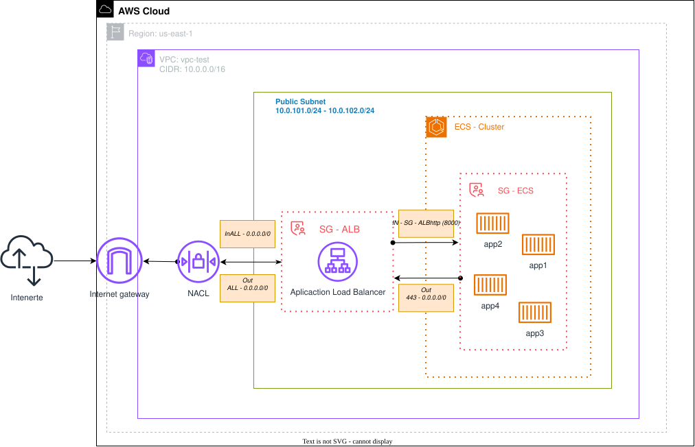
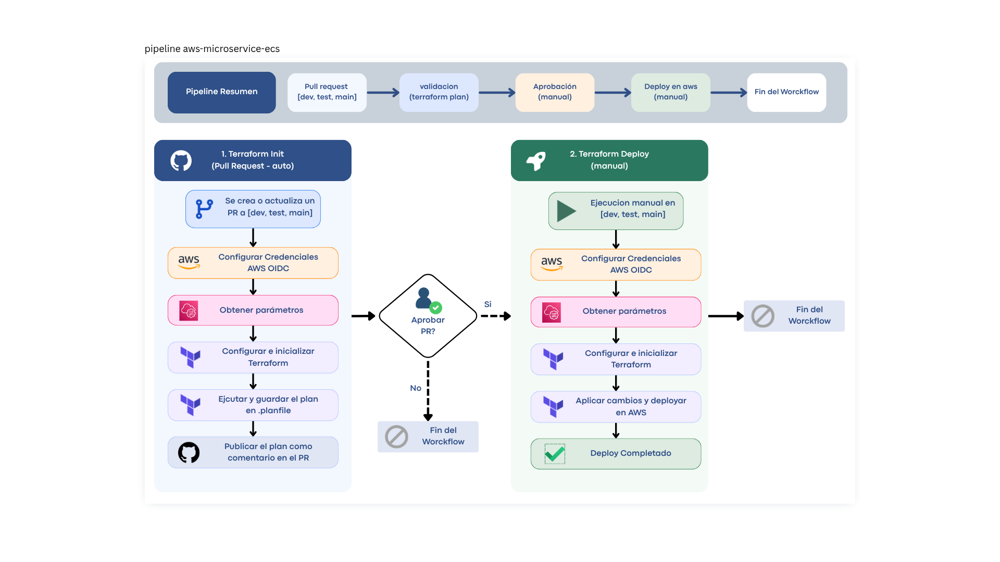

# AWS Microservice ECS

Infraestructura base en AWS para microservicios con ECS Fargate, gestionada con Terraform y desplegada con GitHub Actions.

Despliega una VPC con subredes públicas, un ALB como punto de entrada y un clúster ECS Fargate. Los microservicios se conectan a esa base siguiendo el patrón de `example-service/` (Target Group + Task Definition + ECS Service).

## Infraestructura

- **VPC** (`vpc/`): `10.0.0.0/16` en `us-east-1` (AZ `a`/`b`), 2 subredes públicas (`10.0.101.0/24`, `10.0.102.0/24`). Sin subredes privadas.
- **Security groups** (`vpc/sg-alb.tf`, `vpc/sg-ecs.tf`): `sg_alb` permite 80/443 desde internet; `sg_ecs` solo acepta 8000 desde `sg_alb` y solo sale por 443.
- **ALB** (`alb/`): `alb-<env>` con listener HTTP :80 y respuesta fija ("ALB activo. No hay microservicios configurados"). Sin HTTPS ni Target Groups en la base.
- **ECS** (`ecs/`): clúster Fargate `ecs-cluster-<env>`, vacío en la base (los servicios los crea cada microservicio).
- **microservicio (ejemplo)** (`example/`): Target Group tipo `ip` + Listener Rule por path, Task Definition Fargate e ECS Service con 2 tareas. Lee la base vía `terraform_remote_state` (S3).



> Las apps del diagrama son ilustrativas; la base no crea ningún servicio ECS.

## Pipeline CI/CD

Tres workflows independientes, sin dependencias entre ellos (`ubuntu-latest`, auth OIDC con `AWS_ROLE_STATE_ARN` y parámetros SSM `/$REPO/$RAMA`).

| Workflow | Se inicia con | Qué hace |
|---|---|---|
| `Terraform Init` (`ci-init.yml`) | PR hacia `dev`, `test` o `main` | `init` + `plan` y publica el plan como comentario del PR. No despliega. |
| `Terraform Deploy` (`cd-deploy.yml`) | Manual (`workflow_dispatch`) | `init` + `apply` sobre la rama elegida. Despliega la base en AWS. |
| `Pipeline env & conection` (`pipeline-env.yml`) | Manual (`workflow_dispatch`) | Solo diagnóstico: variables, contexto de GitHub y claims OIDC. |




> La "aprobación" del diagrama es el merge manual del PR por una persona

## Despliegue

- Destino: AWS `us-east-1`, entornos `dev` / `test` / `main` (uno por rama).
- Estado Terraform en S3 `codeparce`, clave `devsu/infra-microservice-aws/<rama>_terraform.tfstate`
- Flujo: PR → revisar el `plan` comentado → merge manual → lanzar `Terraform Deploy` en la rama → `apply`.


## Tecnologías

Terraform (provider AWS `~> 6.0`, módulos `terraform-aws-modules/vpc`, `alb`, `ecs`), GitHub Actions, OIDC, SSM Parameter Store, ALB, ECS Fargate.


## Lab & Test

### Infraestructura

Deploy de la infraestructura para prebas

> Validar archivo .exmaple.env

```bash
set -a && source .exmaple.env && set +a
envsubst < provider.tf.template > provider.tf
terraform init
terraform apply
```

### Micreoservicio

Microservicio de ejemplo para probar la infraesctrucutra

```bash
cd /example
terraform init
terraform apply
```